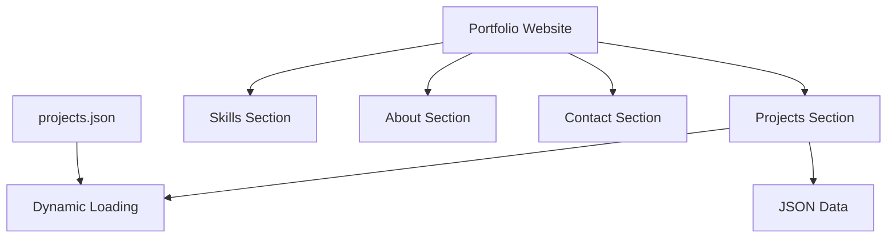

# 👨‍💼 Personal Portfolio Website

<div align="center">


**Modern, Responsive Portfolio with GitHub Integration**

[]()
[](https://github.com/samalarakshithbabu/personal-portfolio/issues)

</div>

---

## 🚀 Executive Summary

A **modern, responsive portfolio website** built with Next.js and Tailwind CSS to showcase projects, skills, and contact information. Features dynamic project loading from JSON, smooth scrolling navigation, and mobile-first design perfect for presenting work professionally.

### What It Does



---

## ✨ Key Features

| Feature | Description |
|---------|-------------|
| **Modern Design** | Clean UI with Tailwind CSS |
| **Fully Responsive** | Mobile, tablet, and desktop |
| **Fast Performance** | Next.js static generation |
| **Dynamic Projects** | Load from projects.json |
| **Smooth Navigation** | Scroll-based section navigation |
| **Easy Deployment** | Vercel or GitHub Pages |

---

## 🛠️ Technology Stack

| Component | Technology | Purpose |
|-----------|------------|---------|
| **Framework** | Next.js 14 | React framework |
| **Styling** | Tailwind CSS | Utility-first CSS |
| **Language** | TypeScript | Type safety |
| **Deployment** | Vercel/ GitHub Pages | Hosting |

---

## 📁 Project Structure

```
personal-portfolio/
├── components/         # Reusable UI components
├── pages/              # Next.js pages
├── public/             # Static assets
├── styles/             # CSS styles
├── projects.json       # Project data
├── next.config.js      # Next.js configuration
├── tailwind.config.js  # Tailwind configuration
├── tsconfig.json       # TypeScript configuration
└── README.md           # This file
```

---

## 🛠️ Installation

### Prerequisites
- Node.js 18+
- npm or yarn

### Setup
```bash
git clone https://github.com/samalarakshithbabu/personal-portfolio.git
cd personal-portfolio
npm install
```

### Development
```bash
npm run dev
# Opens at http://localhost:3000
```

### Production Build
```bash
npm run build
npm start
```

---

## 📝 Customization

### Adding Projects
Edit `projects.json`:
```json
[
  {
    "title": "Project Name",
    "description": "Project description",
    "techStack": ["React", "Node.js"],
    "link": "https://github.com/..."
  }
]
```

---

## ⚠️ Limitations

| Limitation | Description |
|------------|-------------|
| **Single Page** | No blog or CMS |
| **JSON Projects** | No admin panel for management |

---

## 📄 License

This project is licensed under the MIT License.

---

## 👨‍💻 Author

**SAMALA RAKSHITH BABU**

- 📧 Email: samalarakshithbabu7@gmail.com
- 💼 LinkedIn: [samala-rakshith-babu](https://www.linkedin.com/in/samala-rakshith-babu/)
- 🐙 GitHub: [samalarakshithbabu](https://github.com/samalarakshithbabu)

---

<div align="center">

**Built with ❤️ for Professional Presence**

</div>